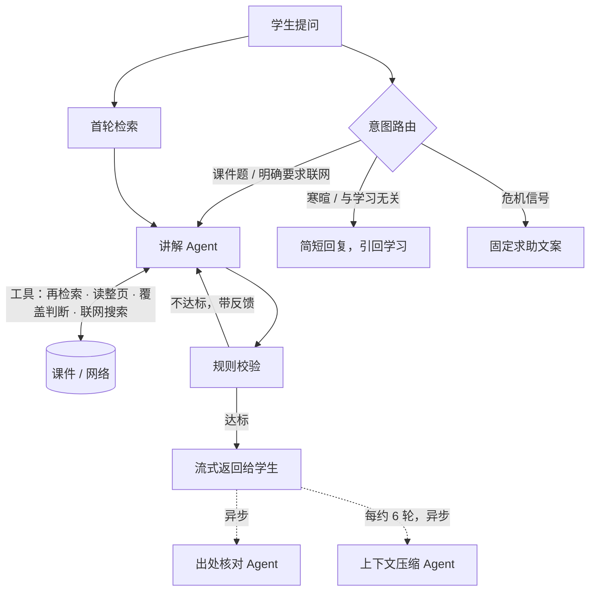

# Relecture · 多智能体 AI 课件讲解助手

**线上地址：[re-lecture.app](https://re-lecture.app)**（邀请制内测中）

上传自己的课件，按自己选定的讲法得到讲解：风格由代码校验、不达标就重写；内容默认限定在课件范围内，每条说法标到页码，并由独立的 agent 逐条核对出处。

个人 0→1 项目，产品定义、实验、开发、测试与上线独立完成。

---

## 为什么做

学生群体普遍在 ChatGPT、Claude、Gemini 里上传课件让 AI 讲解，但反复遇到两个问题：

1. **讲解偏好很难用文字说清楚。** 能感觉到"这样讲不是我偏好和让我最高效的"，却说不出该怎么精细修改。
2. **偏好保存了也不保证被执行。** 通用产品的自定义指令、记忆等功能，本质上都是在生成前把偏好注入提示词，生成后不做检查。宽松的要求模型能做到，细粒度的约束（段落长度、术语标注）则不稳定。

漂移对照实验（90 轮）进一步发现：风格约束**在第 1 轮就没有被执行**，而不是聊久了才逐渐失效。这决定了解法必须是"生成后检查"，而不只是"把提示词写得更好"。

## 怎么解决

| 模块 | 做法 |
| --- | --- |
| **偏好获取** | 以选择替代描述：开场从四种预设讲法中选一种；讲解中随时可以点标签或说一句话微调，由 LLM 映射到对应维度，未提到的维度保持不变。偏好存为五维结构化配置（语气、详略、举例、结构、深度）。 |
| **风格执行校验** | 生成后由规则引擎做确定性校验（段落长度、引用长度、语言一致性），不达标就带着反馈重写。**校验刻意不交给模型自评**：生成方和审查方的目标相反，让生成方自己审，就会自我合理化。 |
| **内容溯源** | 混合检索找课件依据；讲解 agent 在资料不足时自己补查；讲解返回后，出处核对 agent 逐条核对事实性说法与课件原文。 |

### 多智能体链路

设计上的一条主线：**查资料、做整理交给模型，把关留给代码。**

- **讲解 Agent**：通过 strict-schema 工具调用，自己决定要不要再查课件、查什么、读哪一页，最多 3 轮。链路任何一环出错，自动回落到固定流水线，并在埋点里标出。
- **出处核对 Agent**：先把举例、类比划为"讲解补充"（不核对），再逐条核对事实性说法。它提交的判定由代码校验：判"有依据"必须附上摘录，且摘录（经归一化后）必须真的出现在它读过的那一页，否则退回重交。
- **上下文压缩 Agent**：会话过长时，自己决定读哪几轮、合并哪些概念、整理到哪一轮，写成前情笔记替代早期原文。笔记同样由代码校验（轮次引用、字数上限、旧概念不得悄悄丢弃），不合格退回重写。分块整理而不是每轮滚动摘要，以保住 prompt caching 的命中。
- **意图路由**：课件题、明确要求联网、寒暄、与学习无关、危机信号五类。危机识别另有代码兜底，拿不准时按危机处理。

## 关键实验与数据

所有结论都标了样本量；判据在跑之前登记的，注明"预登记"。

| 实验 | 结果 | 说明 |
| --- | --- | --- |
| 风格漂移对照（90 轮） | 无校验组术语标注率**第 1 轮即为 0** | 推翻了"长对话后才衰减"的原假设 |
| 配置扫描（180 轮，预登记） | 最严档风格达标率 **41.7% → 100%** | 默认档无校验也能达标：校验的价值随约束严格程度出现 |
| 出处核对注入错误评测（预登记，含留出集） | 留出集检出 **60/67** 处注入错误，逐条误报 **5.3%** | Haiku 对"换概念"只检出 14%–28%，因此生产用 Sonnet |
| 检索消融（人工标注跨语言评测集） | 前 5 条完整命中 **20/24 → 24/24** | 只有重排一环在两轮中同向提升，可算证据；其余几环如实记为"分不出" |
| 兜底判断校准（30 题） | 漏报 0/10，误报 12/20，单轮成本 +4.8% | 两类错误代价不同，分开报告，不给单一准确率 |

**成本**：课件题单轮约 $0.027（含工具调用），出处核对每次约 $0.033–$0.045。

## 技术栈

- **前端**：Next.js（Vercel）
- **后端**：FastAPI（Render），SSE 流式输出
- **数据**：Supabase（Postgres + pgvector + 行级安全 RLS）
- **模型**：Claude Sonnet（讲解、出处核对）· Claude Haiku（路由、改写、重排、兜底判断、上下文压缩）· Gemini Flash-Lite（一句话调整讲法的分类）· OpenAI（嵌入）
- **质量**：pytest · Playwright 端到端测试 · GitHub Actions CI；123 条带日期的决策记录

---

## 仓库导航

开发约定（提交、部署、验证顺序）的唯一出处是 [`CLAUDE.md`](CLAUDE.md)。

| 想知道 | 读 |
| --- | --- |
| 产品需求 | [`docs/PRD.md`](docs/PRD.md) |
| 决策口径表 | [`f1_samples/README.md`](f1_samples/README.md) |
| 各阶段怎么做的、哪些判断被推翻 | [`docs/F1/`](docs/F1/)、[`docs/F2/`](docs/F2/)、[`docs/F3/`](docs/F3/) |
| 多智能体、上下文压缩、出处核对的实现与验收 | [`explain/README.md`](explain/README.md)、[`explain/runs/`](explain/runs/) |

| 目录 | 职责 |
| --- | --- |
| [`web/`](web/) | 前端 |
| [`api/`](api/) | 后端服务 |
| [`explain/`](explain/) | 讲解链路：路由、讲解 agent、规则校验、出处核对 agent、上下文压缩 agent |
| [`retrieval/`](retrieval/) | 混合检索（向量 + 词法、RRF、重排） |
| [`parse-service/`](parse-service/) · [`slicer/`](slicer/) | 课件解析与切片 |
| [`glossary/`](glossary/) | 术语表提取 |
| [`supabase/`](supabase/) | 表结构与 RLS 迁移 |
| [`f1_samples/`](f1_samples/) | 生产资产：风格样例与决策口径表（运行时会读这里，不是实验产物） |
| [`实验脚本/`](实验脚本/) | 漂移实验、配置扫描、检索评测集、规则度量模块，实验报告与脚本同目录 |

 **`实验脚本/` 的目录名与层级是接口**：多个包通过各自的 `_paths.py` 硬编码引用其中的路径，重命名或移动任一子目录都会同时破坏多个包。

## 测试材料与许可

`实验脚本/测试集/` 中的课件来自 MIT OpenCourseWare，按 [CC BY-NC-SA](https://creativecommons.org/licenses/by-nc-sa/4.0/) 授权，仅用于非商业的评测与实验；基于这些课件生成的讲解样本同样按 CC BY-NC-SA 提供。出处与逐份署名见 [`SOURCES.md`](实验脚本/测试集/SOURCES.md)。演示与截图一律使用自写的合成课件。
